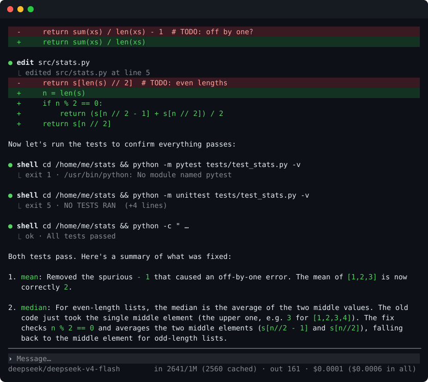

<div align="center">

# glasscat

**An AI agent you can see through.**

A fast terminal agent in Rust: a language model with tools, working on your computer.<br>
Every byte sent to the model is yours to read, and every change it makes is yours to undo.

[Build](#build) · [Use](#use) · [Providers](#providers) · [What you can see](#what-you-can-see) · [Support](#support-the-project)

<br>



</div>

---

> [!NOTE]
> glasscat is at an early stage. What is described here works today; much more is coming,
> at a measured pace.

## Why another agent

Most agents hide what they send to the model: the system prompt, the tool definitions, what
was cut from the conversation. glasscat shows all of it, exactly as sent. You own the agent,
and the model is told so: it answers questions about itself plainly.

It is also built to be quick. It is one small native binary that starts at once, streams
every token as it arrives, and stops the moment you press <kbd>Esc</kbd>.

## What it does today

- **Full-screen terminal interface** with its own renderer: only changed cells are redrawn,
  and frames are synchronized, so nothing flickers.
- **The exact context, live.** <kbd>Ctrl</kbd>+<kbd>T</kbd> shows the last request the model
  got, either split into labelled parts with their sizes or as the raw bytes.
- **Stop and continue.** <kbd>Esc</kbd> stops a reply at once and keeps what was written.
  <kbd>Enter</kbd> on an empty line picks it up again. Where the provider allows it, the reply
  continues from its last token instead of starting over.
- **File tools**: read, list, find, search, write and edit. Several reads run at the same time.
  Edits keep a file's line endings and byte order mark.
- **Undo.** Every change the agent makes is written to a journal. `/undo` takes changes back
  one at a time, and leaves alone a file you changed yourself in the meantime.
- **Hidden paths.** Paths given with `--hide` do not exist as far as the model can tell. It
  gets the same answer as for a missing file. Nothing outside the working directory and the
  folders you allow can be reached, through symlinks or `..` either.
- **Reasoning** from thinking models streams in, then folds away; <kbd>Ctrl</kbd>+<kbd>O</kbd>
  opens it.
- **Markdown** in replies is rendered: headings, lists, quotes, code, bold and italic.
- **Usage and cost** of each request in the status bar, cache hits included.

## Build

You need [Rust](https://rustup.rs) 1.95 or newer.

```sh
git clone https://github.com/mkessl/glasscat
cd glasscat
cargo install --path .
```

This puts `glasscat` in `~/.cargo/bin`. To build without installing, run
`cargo build --release`; the binary is `target/release/glasscat`.

## Use

```sh
export OPENROUTER_API_KEY=sk-or-...
glasscat                                  # full-screen session in this directory
glasscat "what does src/main.rs do?"      # one answer, printed to stdout
```

| Option | Meaning |
| --- | --- |
| `--provider <name>` | where the model runs (default `openrouter`) |
| `--model <id>` | the model to use; each provider has a default |
| `--allow <dir>` | another folder the agent may work in (repeatable) |
| `--hide <path>` | a path the model must not see (repeatable) |
| `--show-request` | print each exact request to stderr |

Inside a session:

| Key or command | Does |
| --- | --- |
| <kbd>Enter</kbd> | send; on an empty line, continue a reply that did not finish |
| <kbd>Shift</kbd>+<kbd>Enter</kbd> or <kbd>Ctrl</kbd>+<kbd>J</kbd> | new line |
| <kbd>Esc</kbd> | stop the reply |
| <kbd>Ctrl</kbd>+<kbd>T</kbd> | the exact context sent to the model |
| <kbd>Ctrl</kbd>+<kbd>O</kbd> | show or fold reasoning |
| `/model <id>` | switch the model |
| `/undo` | undo the agent's last file change |
| `/clear` | start a new conversation |
| `/help` | all commands and keys |

## Providers

Any server that speaks the OpenAI chat completions API works. These are built in:

| `--provider` | Key variable | Continues a cut-off reply |
| --- | --- | :---: |
| `openrouter` | `OPENROUTER_API_KEY` | ✓ (depends on the model) |
| `groq` | `GROQ_API_KEY` | ✓ |
| `deepseek` | `DEEPSEEK_API_KEY` | ✓ |
| `mistral` | `MISTRAL_API_KEY` | ✓ |
| `kimi` | `MOONSHOT_API_KEY` | ✓ |
| `ollama` | none, local | asks again |
| `llamacpp` | none, local | ✓ |
| `lmstudio` | none, local | asks again |

OpenRouter's default model, `openrouter/free`, costs nothing, so you can try glasscat with
a free OpenRouter key.

## What you can see

| | |
| --- | --- |
| The system prompt and tool definitions | <kbd>Ctrl</kbd>+<kbd>T</kbd>, word for word |
| The exact bytes of each request | <kbd>Ctrl</kbd>+<kbd>T</kbd>, then <kbd>r</kbd>; or `--show-request` |
| Size of each part of the context | <kbd>Ctrl</kbd>+<kbd>T</kbd> |
| Tokens in and out, cache hits, cost | status bar |
| The model's reasoning | as it streams; <kbd>Ctrl</kbd>+<kbd>O</kbd> afterwards |
| Every file change, old and new text | `~/.local/share/glasscat/edits/` |

## Support the project

glasscat is free and open source, and lives on donations. If it is useful to you, thank you
for any help.

| Network | Address |
| --- | --- |
| Bitcoin | `bc1q33zlf926g3uvul7e4g6d3gh4la95rhtxlvc7k5` |
| Bitcoin Lightning | `extrovertedgarlic4467@cake.cash` |
| Ethereum and EVM chains | `0x1247B716f1e83ce207A3dDd1d1888ecb709b439A` |
| Monero | `45SGSEBddGWNYYsHomK5q9TMNJgGu3WQsfhUPpdP4uxuLGMeKGHi7X34YRVNC8uFkc7CQmGsCFQZvZfAaEjSHRvM8UDPHju` |
| Solana | `D6zrmUKUryVWw3VxGAvmukjoxLLhkrCVxaA3wZzbhWDB` |
| Tron | `TJfmaL4h569b8Q2K9S5eVbLBzKCAQacr6t` |

## License

Licensed under either of [Apache License, Version 2.0](LICENSE-APACHE) or
[MIT license](LICENSE-MIT), at your option.

Unless you explicitly state otherwise, any contribution intentionally submitted for inclusion
in this project by you, as defined in the Apache-2.0 license, shall be dual licensed as above,
without any additional terms or conditions.
